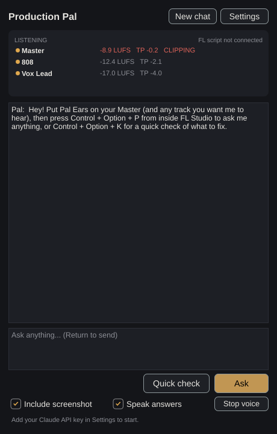
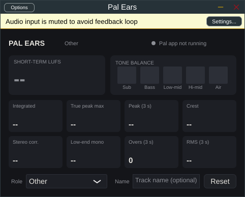

# Production Pal

**An AI production buddy that sits next to you in FL Studio.** Press a hotkey while you work and ask anything: *"Is my vocal sitting right?"*, *"Why does my 808 disappear on my phone?"*, *"Is this loud enough for Spotify?"*. Production Pal looks at your screen, listens to your mix through its meter plugin, reads your mixer, and answers out loud with concrete FL Studio steps.

<p align="center">
  
  &nbsp;&nbsp;
  
</p>

## How it works

```
 FL Studio                                    Production Pal app                 Claude
 ─────────                                    ──────────────────                 ──────
 Pal Ears (VST3/AU) on Master / tracks ──UDP──▶  live meters  ─┐
 FL script (mixer, tempo, FX chain)  ──MIDI──▶  FL state     ─┼──▶ question + screenshot ──▶  answer
 your screen  ──── Control+Option+P ────────▶  screenshot   ─┘                              (spoken)
```

| Part | What it does |
| --- | --- |
| **Pal Ears** (VST3 / AU / Standalone) | Pass-through meter. Measures LUFS (momentary, short-term, gated integrated per ITU-R BS.1770), sample and true peak, RMS, crest factor, stereo and low-end correlation, tone balance in 5 bands, and overs. Streams them to the app twice a second. Never changes the audio. |
| **Production Pal** (app) | Global hotkeys, screenshot of the main display, live list of every Pal Ears instance, Claude API call with a built-in producer knowledge base, answers read aloud. |
| **FL script** | Sends tempo, transport, focused window, Master and selected-track info including their effect slots, and the busiest mixer tracks. See [FLStudio/README.md](FLStudio/README.md). |

### Hotkeys (work while FL Studio is in front)

| Keys | Action |
| --- | --- |
| Control + Option + P | Ask: takes a screenshot of FL first, then focuses the question box (type, or use dictation) |
| Control + Option + K | Quick check: "what's the most important thing to fix right now?", answer spoken |
| Control + Option + S | Stop speaking |

## Install (no building)

Download the latest **Production-Pal-macOS** zip from [Releases](../../releases) (or from the latest [Actions](../../actions) run), open **Production Pal Installer.pkg**, and follow [installer/INSTALL.txt](installer/INSTALL.txt). The installer puts the app in Applications, the VST3 and AU in the system plug-in folders, and the FL script in your FL Studio Hardware folder.

You need a Claude API key from [console.anthropic.com](https://console.anthropic.com). It's stored in a plain settings file in `~/Library/Application Support/Production Pal` on your Mac. You can also set it with the `ANTHROPIC_API_KEY` environment variable.

## Privacy

Nothing leaves your Mac except when you ask a question. Then one screenshot (if "Include screenshot" is on), the meter readings and your question go to the Claude API. Meters and the FL bridge only talk over localhost and a virtual MIDI port.

## Build it yourself

- **Projucer:** open `PalEars/PalEars.jucer` or `ProductionPal/ProductionPal.jucer`. JUCE 9.0.5 is bundled in `JUCE/`, and the Xcode, Visual Studio 2022 and Linux builds are pre-generated in each `Builds/` folder. Every configuration, Debug included, is optimised (-O3).
- **CMake:** `cmake -B build -DCMAKE_BUILD_TYPE=Release && cmake --build build`

Tests: `analyzer_tests` (loudness accuracy against EBU reference tones at 44.1/48/96 kHz, true peak, correlation, bands, real-time budget), `client_tests` (Claude request/response format), `python3 tests/test_fl_script.py` (FL script against fake FL modules). CI builds universal macOS binaries, runs pluginval (strictness 5) and auval, times the analyser on Intel and Apple Silicon, and packages the installer.

## Roadmap

- [x] v0.1: hotkey → screenshot + meters + FL state → Claude → spoken answer
- [ ] Pal can make changes you approve ("turn the 808 down 2 dB?") through the FL script
- [ ] Event triggers (Master clipping, new recording) with a gentle spoken heads-up
- [ ] Push-to-talk voice input, per-project memory, reference-track comparison
- [ ] Epsilon Sounds signature UI pass (logo, typeface, controls)

## License

The Production Pal code is © Epsilon Sounds. It's built on [JUCE](https://juce.com), which is dual-licensed under AGPLv3 and a commercial JUCE licence. Releasing closed-source or commercial builds may require a commercial JUCE licence.
